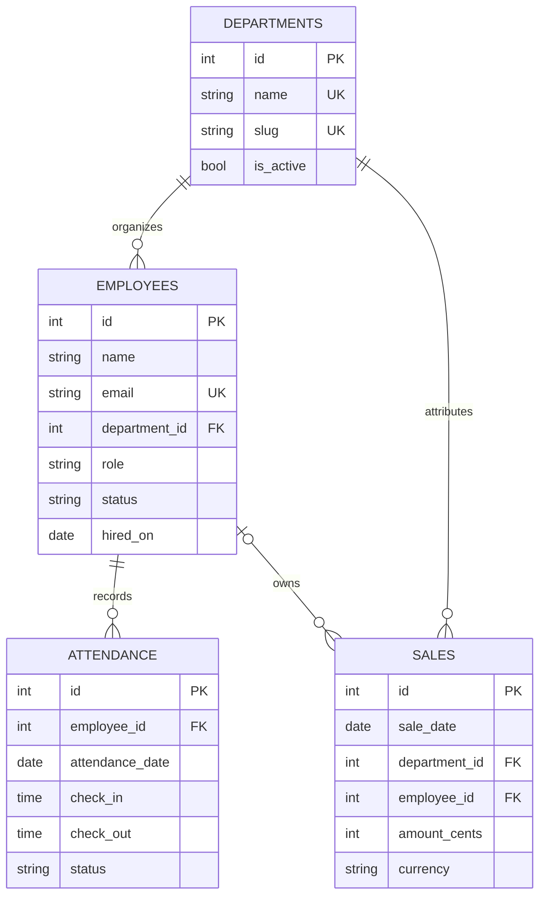

# Database design

The app uses PostgreSQL. `sql/schema.sql` is the canonical schema loaded by the backend on first startup, and `backend/app/database/connection.py` contains the initializer and demo-data seeding logic.

## Entity relationship

## Design choices

- **Departments are reference data.** Employees and sales refer to one department row, so renames do not leave inconsistent free-text labels. The employee API still returns the department name.
- **Money is stored as integer minor units.** `amount_cents` avoids floating-point rounding. Report APIs convert USD cents into dollar amounts for the existing dashboard. Sales breakdowns are grouped by currency.
- **Attendance has one daily row per employee.** A uniqueness constraint prevents duplicate daily entries. Status values are constrained to Present, Absent, Leave, or Remote.
- **Employee email is case-insensitively unique.** A unique expression index on `lower(email)` enforces this. Employee and department rows are restricted from deletion while referenced; employee deactivation preserves attendance and sales history.
- **Indexes follow the current query patterns.** They support employee directory filtering and date-based attendance and sales reports.
- **PostgreSQL is the application database.** IDs use identity columns, dates/times use native types, and timestamps use `TIMESTAMPTZ`.

## Initialization and data migration

On startup, the backend creates any missing tables and indexes, then adds sample employees and sales only when the PostgreSQL employee table is empty. `sql/sample_data.sql` is also available for optional manual seeding. CSV files are import templates and are not loaded automatically.

The previous SQLite database is not migrated automatically. Export and import any SQLite records that need to be retained before switching the app to PostgreSQL. Keep the PostgreSQL connection URL in `.env`; never commit database credentials.
